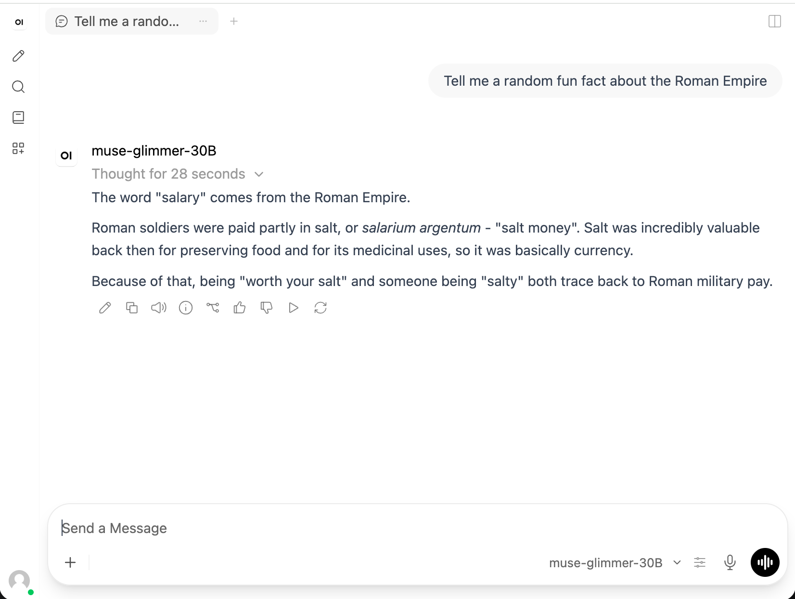

# muse-glimmer

Run [Muse Glimmer 30B](https://ai.meta.ai/research/publications/muse-glimmer-30b-an-on-device-agentic-model/) locally with an OpenAI-compatible chat API. Development preview.

## Install

Use Python 3.11 or newer.

<details>
<summary>Create a Python environment (Conda or uv)</summary>

With Conda:

```sh
conda create -yn glimmer python=3.12
conda activate glimmer
```

Or [uv](https://docs.astral.sh/uv/getting-started/installation/):

```sh
uv venv --python 3.12 --seed .venv
source .venv/bin/activate
```

</details>

### Apple silicon (macOS 26.2+)

```sh
pip install --pre muse-glimmer
```

<details>
<summary>Build from source on macOS</summary>

Requires Git and Xcode with the Metal toolchain:

```sh
sudo xcodebuild -license accept
xcodebuild -downloadComponent MetalToolchain
git clone --recursive https://github.com/mergennachin/muse-glimmer.git
cd muse-glimmer
pip install -e .
```

</details>

### Linux x86_64 (CUDA 13.2)

The default CUDA export was tested on an 80 GB A100. Its prefill kernels need
144 KiB of shared memory per thread block. Ada GPUs, including the RTX 6000 Ada,
have a 99 KiB limit and cannot run this export.

If you have the prebuilt wheel, install it from the directory containing the
download. It requires glibc 2.34+, an x86-64-v2 CPU, and an NVIDIA driver
supporting CUDA 13.2.

```sh
pip install ./muse_glimmer-*-linux_x86_64.whl
```

To build from source, run this from the repository root with Git, Make, the
CUDA 13.2 toolkit, and a C++ toolchain with a GCC 12+ runtime installed.

```sh
pip install -e .
```

## Download and serve

`pull 1.0` selects the 17G DFlash2 model with seven draft proposals on Apple
silicon and the 17G text-solo model on Linux (17.89 GB download).
[Model files on Hugging Face](https://huggingface.co/SocialLocalMobile/Muse-Glimmer-30B-ExecuTorch-PTE)

```sh
muse-glimmer pull 1.0
muse-glimmer serve
```

The server listens at `http://127.0.0.1:8000` and shows activity in the terminal.

## Send a chat request

With the server running, try this in a second terminal. For an OpenAI-compatible
client, use `http://127.0.0.1:8000/v1` as the base URL and `muse-glimmer-30B`
as the model ID.

```sh
curl --fail-with-body http://127.0.0.1:8000/v1/chat/completions \
  -H 'Content-Type: application/json' \
  -d '{
    "model": "muse-glimmer-30B",
    "messages": [{"role": "user", "content": "Say hello."}],
    "max_tokens": 512,
    "temperature": 0.7
  }'
```

Press **Ctrl+C** in the server terminal when you're done. The `--launch`
commands below start their own server on the same port.

## Coding agents

Install [Muse](https://dev.meta.ai/products/muse-code), [Pi](https://github.com/earendil-works/pi),
[Oh My Pi](https://omp.sh), [Hermes Agent](https://hermes-agent.nousresearch.com/),
or [OpenCode](https://opencode.ai), then launch from your project directory:

```sh
muse-glimmer serve --launch muse
```

Replace `muse` with `pi`, `omp`, `hermes`, or `opencode` as needed.
No API key is needed. Exiting the agent stops the server.


## Chat UI

With [uv](https://docs.astral.sh/uv/getting-started/installation/) installed, set up and launch [Open WebUI](https://openwebui.com/):

```sh
uv tool install --python 3.12 open-webui==0.13.3
muse-glimmer serve --launch open-webui
```

Your browser opens at `http://127.0.0.1:8080`. Chats are saved locally. **Ctrl+C** stops both servers.



## Options

Use `pull --list` to see the recommended, downloaded, and selected variants
for your machine.

```sh
muse-glimmer pull --list
muse-glimmer pull --help
muse-glimmer serve --help
```

In a `--config` file, use top-level settings for both platforms and
`[backends.metal]` or `[backends.cuda]` for overrides.
[default_config.toml](default_config.toml) lists the defaults.
