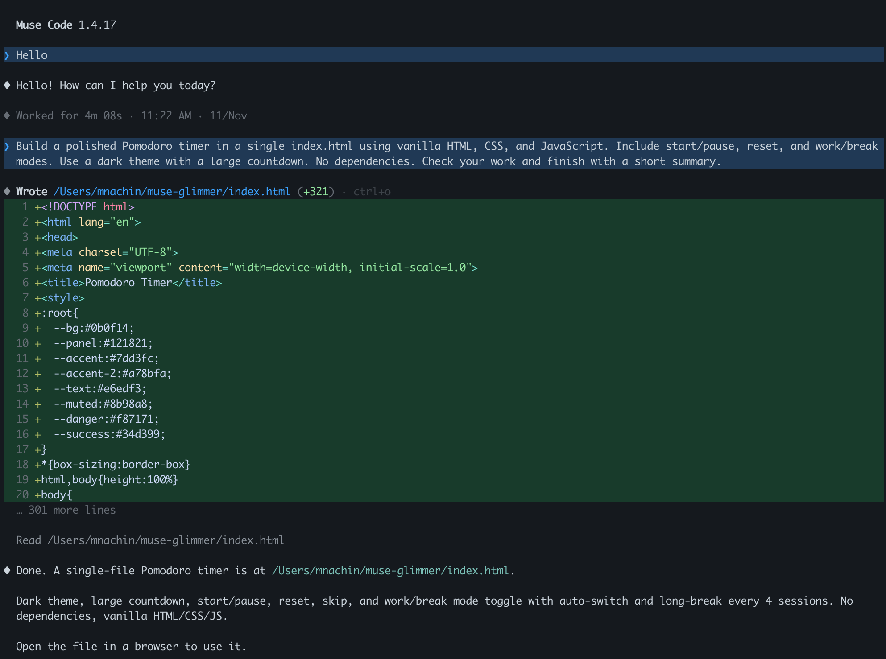
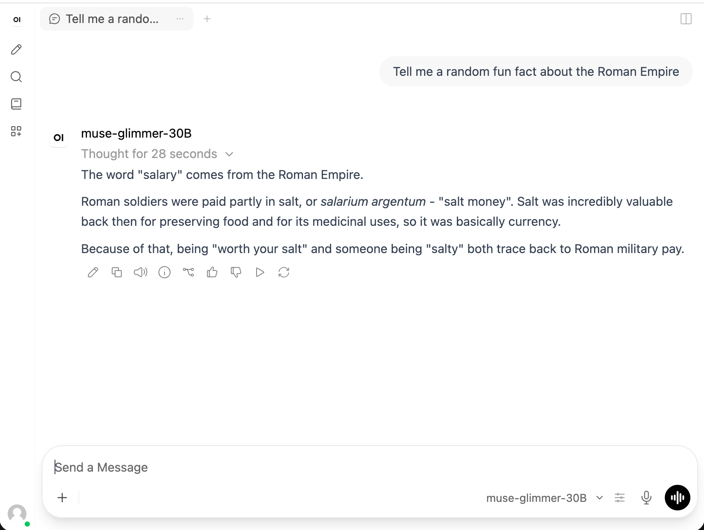

# muse-glimmer

Serve [Muse Glimmer 30B](https://ai.meta.com/research/publications/muse-glimmer-30b-an-on-device-agentic-model/) locally. Development preview.

## Supported platforms

- macOS on Apple silicon

## Install and serve

You need Python 3.11+, Git, and Xcode with the Metal toolchain.
Since Xcode 26 the Metal toolchain is a separate download. After installing or updating Xcode, run once:

```sh
sudo xcodebuild -license accept
xcodebuild -downloadComponent MetalToolchain
```

The first installation needs an internet connection. From this repository:

```sh
pip install -e .
muse-glimmer pull 1.0
muse-glimmer serve
```

Use `pull 1.0 --variant <folder-name>` to choose a checkpoint,
or `serve --model <path>` for a local model.

The server runs at `http://127.0.0.1:8000`. Press **Ctrl+C** to stop.
The terminal shows a live HUD.

## Run Muse (coding agent) with the local model

With [Muse](https://dev.meta.ai/products/muse-code) installed, run this from your project directory:

```sh
muse-glimmer serve --launch muse
```

Muse uses the local model through its OpenRouter provider. No API key is needed.
Exiting Muse also stops the server.



## Chat with Open WebUI

Install [uv](https://docs.astral.sh/uv/getting-started/installation/) and Open WebUI once:

```sh
uv tool install --python 3.12 open-webui==0.13.3
muse-glimmer serve --launch open-webui
```

Your browser opens at `http://127.0.0.1:8080` with Muse Glimmer selected. No login is needed.
Chat history is saved locally. The HUD stays in the terminal; **Ctrl+C** stops both servers.



## Smoke test

With the server running, open another terminal:

```sh
curl --fail-with-body http://127.0.0.1:8000/v1/chat/completions \
  -H 'Content-Type: application/json' \
  -d '{
    "model": "muse-glimmer-30B",
    "session_id": "demo",
    "messages": [
      {"role": "system", "content": "Reasoning strength: low"},
      {"role": "user", "content": "Say hello."}
    ],
    "max_tokens": 512,
    "temperature": 0.7
  }'
```

A successful response contains an assistant message in `choices[0].message.content`.
Requests appear under `demo` in the HUD; change `session_id` for another session.

## Configuration

[default_config.toml](default_config.toml) documents all settings and defaults.
To override them, pass a TOML file explicitly:

```sh
muse-glimmer serve --config ./config.toml
```

Run `muse-glimmer serve --help` for command-line options.
