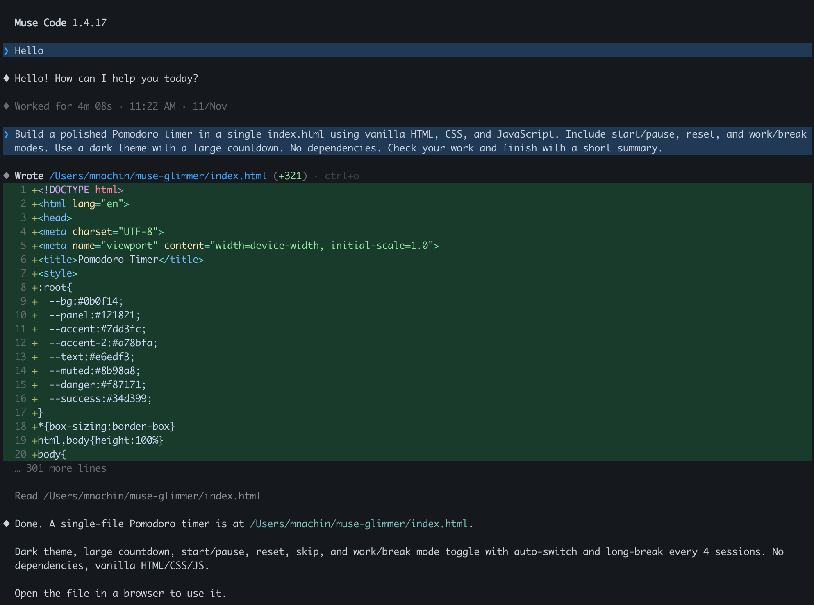

# muse-glimmer

Serve [Muse Glimmer 30B](https://ai.meta.com/research/publications/muse-glimmer-30b-an-on-device-agentic-model/) locally. Development preview.

**Platforms:** macOS 26.2+ on Apple silicon, and Linux x86_64 with an NVIDIA GPU and a driver supporting CUDA 13.2. Requires Python 3.11+.

Linux CUDA wheels and exports are currently built from source; the published model catalog contains Apple silicon exports.

## Quickstart

```sh
pip install --pre muse-glimmer
muse-glimmer pull 1.0
muse-glimmer serve
```

Uses the 17G DFlash2 model with seven draft proposals. Serves at `http://127.0.0.1:8000`
with a live terminal HUD. **Ctrl+C** stops it.

<details>
<summary>Create a Python environment (Conda or uv)</summary>

With Conda:

```sh
conda create -yn glimmer python=3.12
conda activate glimmer
```

Or [uv](https://docs.astral.sh/uv/getting-started/installation/):

```sh
uv venv --python 3.12 --seed .venv
source .venv/bin/activate
```

</details>

<details>
<summary>Install from source</summary>

Requires Git and Xcode with the Metal toolchain:

```sh
sudo xcodebuild -license accept
xcodebuild -downloadComponent MetalToolchain
git clone --recursive https://github.com/mergennachin/muse-glimmer.git
cd muse-glimmer
pip install -e .
```

</details>

## Linux CUDA 13.2

Build with a CUDA 13.2 toolkit, a C++ compiler, Git, and Python 3.11+:

```sh
python -m pip install build
export CUDA_HOME=/usr/local/cuda-13.2
export PATH="$CUDA_HOME/bin:$PATH"
export TORCH_CUDA_ARCH_LIST="8.0 8.6 8.9 9.0 10.0 12.0+PTX"
python -m build --wheel
pip install dist/*-linux_x86_64.whl
```

The wheel bundles the native worker and CUDA runtime dependencies. Serving needs
an NVIDIA driver, but does not need PyTorch, a CUDA toolkit, or a source checkout.
The initial wheel uses the `linux_x86_64` tag; its system-library requirements
come from the build host. It is not a manylinux wheel.
The current CUDA 13.2 export also requires `libstdc++` providing
`GLIBCXX_3.4.30` (GCC 12+) at runtime; an older system library can prevent model
loading even when the worker's startup check passes.

For a local CUDA text-only solo export, keep its PTE and `aoti_cuda_blob.ptd` in
the same directory, then start the server:

```sh
muse-glimmer serve --model /path/to/muse-glimmer-k-quant-17G-128K-text-solo-cuda --context 8191
```

Linux defaults to solo decoding. The export supports positions up to 128K,
but its 131072-cell KV pool must also fit every reserved session, cached prefix,
and in-progress prefix capture at the configured context length. One cell is
reserved for padding. The default four sessions, eight cached prefixes, and four
capture slots reserve 16 contexts, so `--context 8191` fits this export. The
package's default 128K serving context exceeds this pool and prevents startup;
pass the smaller context explicitly. Larger contexts require fewer reserved slots
or an export with a larger KV pool.

To reproduce the export, install the pinned ExecuTorch revision's export
dependencies and PyTorch 2.15.0 with CUDA 13.2, then run:

```sh
hf download meta-models/Muse-Glimmer-30B-GGUF \
  Muse-Glimmer-30B-KQuant-17GB-Q4_K_M.gguf \
  --revision b44f1072cf75e918a1b82a3a17b45c4389b076e7 --local-dir models
python packaging/export_cuda.py \
  --checkpoint models/Muse-Glimmer-30B-KQuant-17GB-Q4_K_M.gguf
```

The script checks the GGUF checksum, exports with BF16 activations and off-graph
KV caching, and writes source revisions, tool versions, GPU architecture, settings,
and checksums to `provenance.json`. It uses static forward sizes `1,4` plus a
dynamic method up to 512 tokens, following CI's smaller batching configuration.
Use `--forward-sizes 1,2,4,8,16,32,64` to compile additional optimized batch sizes;
each size adds a separate AOTI compilation and autotuning pass. Per-method compile
times are logged during export. CUDA PTE kernels are compiled on the export
GPU with PTX included for forward compatibility; verify performance and
correctness on other GPU architectures before distributing the export.

## Coding agents

Install [Muse](https://dev.meta.ai/products/muse-code), [Pi](https://github.com/earendil-works/pi),
[Oh My Pi](https://omp.sh), [Hermes Agent](https://hermes-agent.nousresearch.com/),
or [OpenCode](https://opencode.ai), then launch from your project directory:

```sh
muse-glimmer serve --launch muse
```

Replace `muse` with `pi`, `omp`, `hermes`, or `opencode` as needed.
No API key is needed. Exiting the agent stops the server.



## Chat UI

With [uv](https://docs.astral.sh/uv/getting-started/installation/) installed, set up and launch [Open WebUI](https://openwebui.com/):

```sh
uv tool install --python 3.12 open-webui==0.13.3
muse-glimmer serve --launch open-webui
```

Your browser opens at `http://127.0.0.1:8080`. Chats are saved locally. **Ctrl+C** stops both servers.


## Smoke test

With the server running, open another terminal:

```sh
curl --fail-with-body http://127.0.0.1:8000/v1/chat/completions \
  -H 'Content-Type: application/json' \
  -d '{
    "model": "muse-glimmer-30B",
    "messages": [{"role": "user", "content": "Say hello."}],
    "max_tokens": 512,
    "temperature": 0.7
  }'
```

## Options

For model selection, downloads, and server options:

```sh
muse-glimmer pull --help
muse-glimmer serve --help
```

[default_config.toml](default_config.toml) documents the configuration settings.
